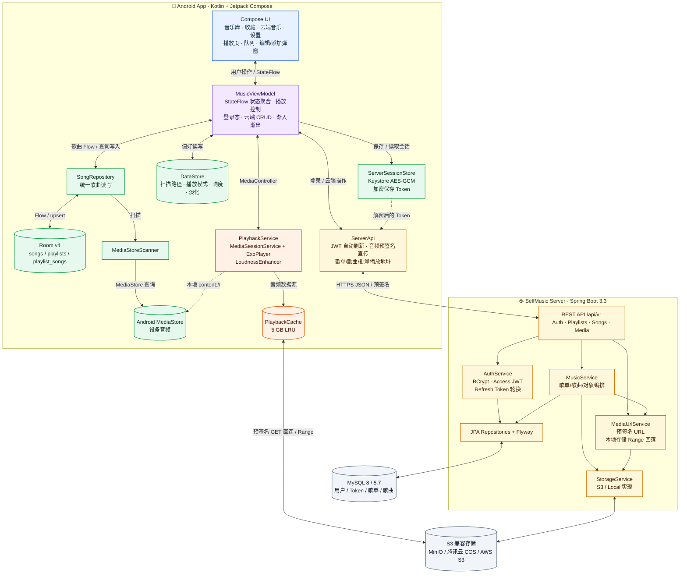
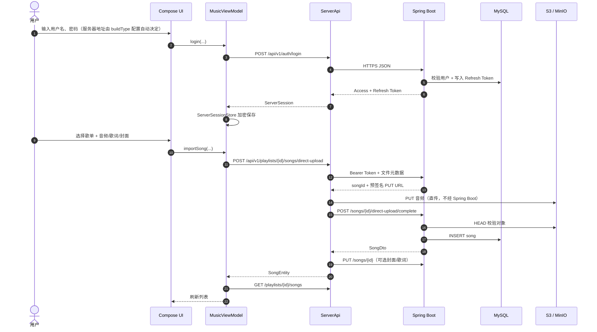
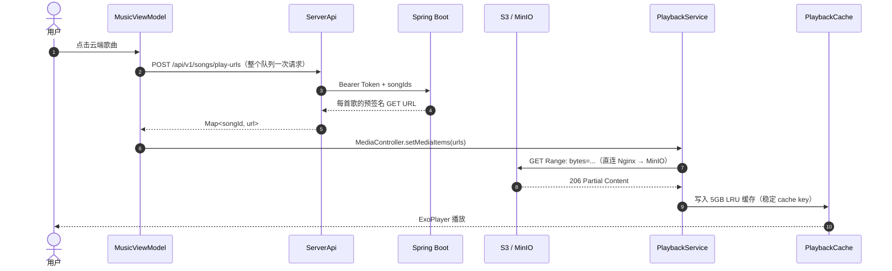

# SelfMusic 架构（自建服务器版）

> Android 0.1.0 · Spring Boot 3.3 · Java 17 · MySQL 8 / 5.7 · S3 兼容对象存储
>
> 旧的腾讯云 COS 直连/SCF 方案已从 Android 客户端移除；`SelfMusicServer/legacy/cos-scf` 仅作历史参考保留。

## 1. 总体架构



### 分层依赖

```text
Compose UI  →  MusicViewModel  →  SongRepository  →  Room / MediaStoreScanner
                    │
                    ├─→ DataStore（普通偏好）
                    ├─→ ServerSessionStore（加密 Token）
                    ├─→ ServerApi（登录 / 歌单 / 歌曲 / 批量播放地址）
                    └─→ MediaController（播放控制）

ServerApi  →  Spring Boot REST API
                    ├─→ AuthService       →  users / refresh_tokens
                    ├─→ MusicService      →  playlists / songs
                    └─→ MediaUrlService   →  预签名 URL（S3）或 Range（本地）
                                                   │
                                                   ├─→ MySQL（元数据）
                                                   └─→ Nginx → MinIO / S3（音频、封面、歌词）
```

## 2. 仓库结构

```text
SelfMusic/
├─ SelfMusicApp/                           # Android 工程（独立 Gradle 项目）
│  ├─ app/
│  │  ├─ build.gradle.kts
│  │  └─ src/main/
│  │     ├─ AndroidManifest.xml            # 权限、明文 HTTP、MainActivity、PlaybackService
│  │     └─ java/com/selfmusic/
│  │        ├─ MainActivity.kt             # Activity + MusicViewModel + Compose UI
│  │        ├─ data/
│  │        │  ├─ SongRepository.kt
│  │        │  ├─ local/
│  │        │  │  ├─ AppDatabase.kt         # Room v4
│  │        │  │  └─ MusicSettings.kt       # DataStore 偏好
│  │        │  ├─ media/
│  │        │  │  └─ MediaStoreScanner.kt
│  │        │  ├─ server/
│  │        │  │  ├─ ServerApi.kt           # 自建服务器 API 客户端
│  │        │  │  ├─ ServerSession.kt
│  │        │  │  └─ ServerSessionStore.kt  # Keystore 加密会话
│  │        │  └─ cloud/
│  │        │     └─ CloudPlaylist.kt
│  │        └─ playback/
│  │           ├─ PlaybackService.kt
│  │           └─ PlaybackCache.kt
│  ├─ gradle/ + gradlew + gradlew.bat      # Gradle Wrapper
│  ├─ settings.gradle.kts / build.gradle.kts
│  ├─ .android-sdk/                        # 本地 Android SDK
│  ├─ .android-avd/                        # 模拟器 AVD
│  ├─ design/                              # 图标 / 动画素材
│  ├─ tools/                               # 素材处理脚本
│  ├─ docs/                                # 架构与项目总览
│  └─ SelfMusic.bat / SelfMusic.ps1        # 模拟器与 App 启停脚本
└─ SelfMusicServer/                        # 自建后端（独立 Maven 项目）
   ├─ pom.xml
   ├─ Dockerfile
   ├─ docker-compose.yml                   # MySQL + MinIO + Server
   ├─ .env.example
   ├─ README.md                            # 部署、环境变量、API
   ├─ src/
   │  ├─ main/java/com/selfmusic/server/
   │  │  ├─ api/                           # Auth/Playlist/Song/Media Controller + DTO
   │  │  ├─ auth/                          # AuthService、RefreshToken
   │  │  ├─ config/                        # AppProperties、SecurityConfig、S3Config
   │  │  ├─ media/                         # 媒体 token、Range 流
   │  │  ├─ music/                         # 歌单/歌曲实体、Repository、MusicService
   │  │  ├─ security/                      # JWT、过滤器、UserPrincipal
   │  │  ├─ storage/                       # StorageService、S3/Local 实现
   │  │  ├─ user/
   │  │  └─ common/                        # 异常与统一错误响应
   │  ├─ main/resources/
   │  │  ├─ application.yml
   │  │  ├─ application-dev.yml
   │  │  └─ db/migration/V1__init.sql
   │  └─ test/java/                        # 认证、音乐、媒体 token/Range 测试
   └─ legacy/cos-scf/                      # 旧版 COS 签名服务（Legacy）
```

## 3. 模块职责

### Android

| 模块 | 职责 |
|---|---|
| `MainActivity.kt` / Compose UI | 四个 Tab、播放页、队列、云端管理、登录页、设置、编辑/添加弹窗 |
| `MusicViewModel` | 聚合 StateFlow；登录/退出；歌单/歌曲 CRUD；播放控制；渐入渐出 |
| `SongRepository` | 统一歌曲查询与写入；扫描入库；收藏；云歌曲替换 |
| `AppDatabase` | Room v4：`songs`、`playlists`、`playlist_songs` |
| `MusicSettings` | DataStore：扫描路径、播放模式、响度、淡化 |
| `MediaStoreScanner` | 查询系统音频媒体库 |
| `ServerApi` | OkHttp + JSON/multipart；Bearer Token；401 自动刷新并重试；媒体 URL 拼接 |
| `ServerSessionStore` | Android Keystore AES-GCM 加密保存 access/refresh token |
| `PlaybackService` | MediaSessionService + ExoPlayer；响度增强 |
| `PlaybackCache` | 5 GiB LRU 磁盘缓存 |

### 后端

| 模块 | 职责 |
|---|---|
| `AuthController` / `AuthService` | 注册、登录、刷新、退出；BCrypt；用户信息 |
| `JwtService` / `JwtAuthenticationFilter` | 签发/校验 Access JWT；填充 SecurityContext |
| `RefreshTokenService` | 随机 Refresh Token、SHA-256 存储、轮换、撤销、过期清理 |
| `PlaylistController` / `SongController` | 歌单与歌曲 REST API；multipart 上传 |
| `MusicService` | 归属校验、对象 Key、歌词读取、移动/删除、DTO 映射 |
| `MediaTokenService` / `MediaUrlService` | HMAC 短时媒体 token；生成播放/封面 URL |
| `MediaController` / `MediaStreamService` | 校验 token；Range 解析；S3/本地流式输出 |
| `StorageService` | 统一对象存取；`S3StorageService` / `LocalStorageService` |
| `JPA + Flyway` | `users`、`refresh_tokens`、`playlists`、`songs`；启动迁移 |
| `MySQL` | 用户登录数据与音乐元数据 |
| `S3 / MinIO` | 音频、封面、歌词对象 |

## 4. 核心链路

### 4.1 登录 + 上传



### 4.2 播放



### 4.3 认证与媒体地址

- Access Token：JWT，默认 30 分钟，放在 `Authorization: Bearer`。
- Refresh Token：随机 32 字节，数据库存 SHA-256，默认 30 天；每次刷新轮换旧 token。
- S3/MinIO 模式：后端签发预签名 GET/PUT URL，默认 6 小时；App 直连 Nginx/MinIO，不再经过 Spring Boot。
- 本地磁盘模式：回落到 HMAC token + 后端 Range 流式转发。
- 媒体 URL 不需要 JWT Header，ExoPlayer 可直接使用；缓存 key 使用 `cloudId + objectVersion`，token 变化不会击穿缓存。
- Android 会话：Keystore AES-GCM 加密后写入 SharedPreferences；应用关闭云备份。

## 5. 数据与对象布局

### MySQL

支持 MySQL 5.7 / 8.0。时间列使用 `DATETIME(6)`，由 Hibernate 按 UTC 读写；外键使用显式
`FOREIGN KEY ... ON DELETE CASCADE`，避免 MySQL 忽略列定义中的内联 `REFERENCES`。

```text
users
  id, username, password_hash, display_name, created_at, updated_at

refresh_tokens
  id, user_id, token_hash, expires_at, revoked, user_agent, created_at

playlists
  id, user_id, name, cover_object_key, sort_order, created_at, updated_at

songs
  id, user_id, playlist_id, title, artist, album, duration_ms,
  mime_type, file_size, audio_object_key, cover_object_key, lyric_object_key,
  lyrics_text, lyric_speed, lyrics_offset_ms, object_version,
  is_favorite, play_count, last_position_ms, sort_order, created_at, updated_at
```

### S3 / MinIO

```text
users/{userId}/
  songs/{songId}/
    audio.mp3
    cover.jpg
    lyrics.lrc
  playlists/{playlistId}/
    cover.jpg
```

数据库只保存 ObjectKey 和元数据；播放地址由后端临时签发，不保存永久 URL。

## 6. 关键设计点

1. **控制面/数据面分离**：Android 的登录、歌单元数据只访问 `ServerApi`；音频字节通过后端签发的短时预签名 URL 直连 Nginx/MinIO，App 不持有对象存储密钥。
2. **预签名直连 + 本地回落**：S3/MinIO 使用预签名 GET/PUT；本地磁盘开发环境回落到后端 Range 流式转发，两种模式对 UI 透明。
3. **双 Token**：短期 Access JWT + 可撤销/轮换的 Refresh Token；Android 401 自动刷新并重试一次。
4. **本地/云端统一模型**：`SongEntity` 用 `sourceType=CLOUD` 标记服务器歌曲；播放、收藏、歌词编辑复用同一套 UI。
5. **缓存失效**：服务端每次编辑更新 `objectVersion`，Android 用 `server:{cloudId}:{version}` 作为 Media3 缓存 key。
6. **多用户隔离**：所有歌单/歌曲查询都带 `userId` 条件；本地媒体 token 绑定 `userId`，S3 模式的对象 Key 也包含用户目录，越权返回 404。
7. **部署最小化**：Docker Compose 启动 MySQL、MinIO 和 Spring Boot；宿主机 Nginx 提供 API 与 `/selfmusic/` 媒体入口，MinIO 初始化容器负责建 Bucket。

## 7. 现状与后续建议

| 观察 | 建议 |
|---|---|
| `MainActivity.kt` 已超过 1000 行，Activity、ViewModel、全部 UI 混在一起 | 拆为 `ui/`、`viewmodel/`、`theme/`；页面用 Navigation Compose |
| Android 一次只保存一个服务器账号 | 多账号切换可增加账号列表；当前退出再登录即可 |
| 后端已存 `play_count` / `last_position_ms`，但没有对应 API | 增加播放进度同步接口，实现跨设备续播 |
| 云端歌曲列表一次性加载，没有分页/服务端搜索 | 大曲库时增加 `page/size` 与 `q` 参数；Android 端做懒加载 |
| Android 端没有自动化测试 | 优先为 `ServerApi` 的 JSON 映射、401 刷新、Token 加密存储加单元测试 |
| `fallbackToDestructiveMigration()` 仍在 | 生产前移除，补齐 Room 迁移测试 |
| 局域网默认允许 HTTP | 公网部署必须使用 HTTPS；可在设置页增加“仅 HTTPS”开关 |
| 旧 COS 代码仍保留在 `SelfMusicServer/legacy/cos-scf` | 新部署不需要；确认不再迁移旧数据后可删除 |
| 没有旧 COS 数据迁移工具 | 如需迁移，写一次性脚本：下载 COS 对象 → 调后端上传接口 |
